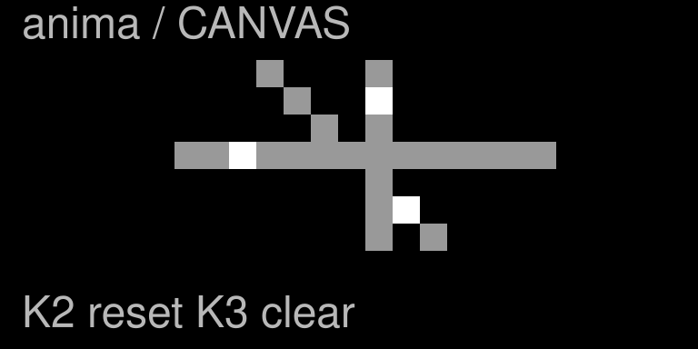
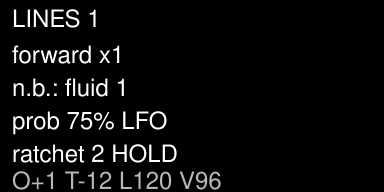
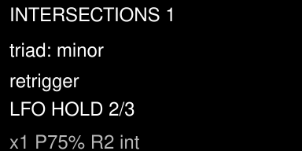
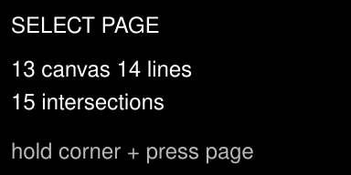
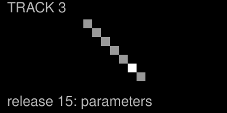

# Anima

**Anima** is an eight-track, two-dimensional sequencer for monome norns and a 16×8 Grid. Draw lines on the Grid; their active steps generate notes as their playheads advance and meet. Each track can use its own clock division, direction, articulation, modulation and output route.

Anima is an adaptation and extension of [Animator by Crim](https://github.com/crimclark/animator). It imports original Animator doodles, and can optionally run imported projects with Animator's original playback rules.

> **Release status:** version 0.5.6 is the prepared release build. Its interface and software behavior have been exercised in local simulations; hardware checks for audio, MIDI, Crow, n.b. voices and the Grid remain necessary. See [verification notes](docs/VERIFICA_IT.md).

## Install

You need **norns**, a **16×8 Grid** and **Molly the Poly**. MIDI, Crow and n.b. are optional output destinations.

1. If Molly the Poly is not already installed, enter this in the [Maiden](https://monome.org/docs/norns/maiden/) REPL:

   ```text
   ;install https://github.com/markwheeler/molly_the_poly
   ```

2. Restart norns to load the engine, then install Anima:

   ```text
   ;install https://github.com/giovannilami/anima
   ```

3. Connect Grid and select **anima** in the norns **SELECT** menu. Draw a line using the two-endpoint gesture described below. Set the scale and sound in **PARAMETERS → EDIT**; configure each track's output under **TRACK**.

Anima requires both the `MollyThePoly` engine and its Lua library. For a manual installation, copy `anima.lua` and the complete `lib/` folder into `dust/code/anima/`. The documentation and local tests are not required on norns. Installed n.b. libraries and voice mods determine which n.b. voices are available; Anima does not bundle them.

## Three performance pages

**Canvas** is for drawing and arranging the sequences. **Lines** controls how each track plays. **Intersections** chooses what happens when playheads meet. The Grid layout and the norns readout change together when you switch page.

The images below are enlarged **2:1 screen schematics**, matching the proportions of the 128×64 norns display. Their text and row positions follow the script's screen code; values are examples. Canvas cells are enlarged for clarity, with diagonally adjacent steps touching at their corners. The device uses smaller, spaced squares and its own font.

### Canvas: draw the sequences



Each line is a track, with its own playhead travelling through its steps. Up to **eight tracks** share a **16-column × 7-row** drawing area. The bottom Grid row contains performance controls. A cell's pitch comes from the composition's scale and global transpose settings. Changing a line's position changes the cells it visits and the pitches it plays.

To draw, hold one Grid pad, press a second pad for the other endpoint, then release. Endpoints must share a row, a column, or form a **45-degree diagonal**: the horizontal and vertical distances must be equal. A diagonal advances by exactly one column and one row at each step. Other slopes do not create a sequence.

The illustration contains three tracks: a horizontal line, a vertical line and a diagonal crossing both. These are three distinct crossing cells. A drawn crossing is a possible meeting point; the intersection actions occur when sounding playheads meet there on the same pulse, depending on their timing and settings.

Tap a cell on an existing line to enable or disable that step. A cell shared by several lines has a shared step-on state. Bright points show current enabled steps; other enabled cells are dimmer, and disabled cells remain faint. Hold a line's two endpoints to delete that line.

| norns control | On Canvas |
| --- | --- |
| E2 | Move all lines vertically |
| E3 | Move all lines horizontally |
| K2 | Reset playback positions |
| K3 | Clear the Canvas |

| Bottom Grid row | Action |
| --- | --- |
| 1–8 | Recall snapshots |
| Hold 15 + press 1–8 | Overwrite a snapshot |
| 10–11 | Snapshot sequence record/play controls |
| 13 | Undo a manual edit |
| Hold 15 + press 13 | Redo |
| 15 | ALT modifier |
| Hold 16 | Open page selection |
| 9, 12, 14 | Unassigned |

The footer normally reads `K2 reset   K3 clear`. Save feedback temporarily replaces it. Undo/redo covers manual drawing, deletion, step toggles, clear and encoder moves during the current session.

### Lines: control each track



Each Grid row represents one track. Select a track with **E1**, or use that track's controls on Grid. The norns screen reports the selected track; **E2** moves that track vertically and **E3** moves it horizontally.

| Grid column | Action on that row's track |
| --- | --- |
| 1 | Tap to mute; hold for solo |
| 2–5 | Forward, reverse, pendulum, random |
| 6 | Tap to enable ratchet; hold to freeze/release its modulated value |
| 7 | Tap to enable probability; hold to freeze/release its modulated value |
| 8 | Unassigned separator |
| 9–15 | Rate: ×2, ×1, ÷2, ÷3, ÷4, ÷6, ÷8 |

Set probability percentage, ratchet count, output and other track values in **PARAMETERS → EDIT → TRACK**. A long press on ratchet or probability performs the hold gesture without also toggling the control. Frozen controls blink on Grid.

Read the example screen from top to bottom:

| Screen row | Meaning in the example |
| --- | --- |
| `LINES  1` | Track 1 is selected. `ORIG` is appended when original Animator playback is active. |
| `forward x1` | Forward playback at the base rate. `MUTE` and `SOLO` appear here when active. |
| `n.b.: fluid 1` | Output route and, for n.b., the assigned voice. Long names are shortened to fit. |
| `prob 75% LFO` | Probability is enabled and its current value comes from an LFO. |
| `ratchet 2 HOLD` | Ratchet is enabled with two strikes; its modulated value is frozen. |
| `O+1 T-12 L120 V96` | Other assigned modulation targets: octave, semitone transpose, note length in milliseconds and velocity. |

`BASE` means the manual value, `LFO` a moving modulated value, and `HOLD` a frozen value. The bottom row only lists assigned destinations; `*` marks a frozen one. An `off` suffix means probability or ratchet is disabled. `INT` on the ratchet row indicates that the count is used for intersection retrigger instead of continuous ratchet.

### Intersections: change what a meeting does



Choose one harmonic action and one rhythmic action for each track. These act when multiple eligible playheads reach the same enabled cell on the same pulse. Different rates, directions, rests and probability settings change when those meetings occur. A visible crossing alone does not continuously apply an action.

Each Grid row still represents a track. Press its desired action to select it; press that same pad again to return that action group to `none`. Harmonic and rhythmic actions can be combined.

| Grid column | Action |
| --- | --- |
| 1–5 | Octave up, octave down, fifth, triad, seventh |
| 6 | Unassigned separator |
| 7–12 | Mute, retrigger, reverse, reset self, reset others, reset all |
| 13 | Unassigned |
| 14 | Tap to switch the track's LFO master on/off; hold to freeze/release all assigned destinations |
| 15 | Hold to preview that row's track on the norns screen |

Choose the triad or seventh type in **PARAMETERS → EDIT → TRACK**. **E1** selects the track; **E2/E3** move it. Available actions on existing tracks are dim, selected actions bright, and frozen controls blink. Empty rows remain dark.

In the example, track 1 produces a **minor triad** and **retriggers** when it participates in a meeting. `LFO HOLD 2/3` means two of its three active mapped destinations are frozen; the remaining destination can continue moving. The footer reports the effective rate, probability and ratchet count: `x1  P75%  R2 int`.

The LFO line can also show `off`, `ON`, or `ON no targets`. The footer uses `Poff` or `Roff` when the corresponding control is disabled. `R2 int` means two strikes for intersection retrigger while continuous ratchet is off. Screen values refresh about ten times per second when modulation is moving; musical values are sampled at step boundaries.

### Switch page



Hold the bottom-right Grid pad **(16,8)**, press one of these pads, then release:

| Pad | Page |
| --- | --- |
| (13,8) | Canvas |
| (14,8) | Lines |
| (15,8) | Intersections |

The temporary `SELECT PAGE` screen reminds you of these shortcuts. Holding the corner alone leaves the current page selected. While it is held, navigation takes priority over other bottom-row controls, including undo and track 8's controls.

### Preview one track



On Intersections, hold **column 15 on a track's row**. The norns screen temporarily shows only that track's drawing and moving playhead, while Grid stays on Intersections. `TRACK 3` identifies the track in this example. Release the pad to return to its parameter readout, as the footer `release 15: parameters` indicates.

This lets you inspect a line while keeping the intersection controls available. It is a temporary view, not a fourth performance page.

## Save, load and import

Anima stores its projects in `dust/data/anima/`. Use **PARAMETERS → EDIT → SAVE/LOAD → save doodle / load doodle** for Anima projects. Keep the `.doodle` and its matching `.pset` together: the preset contains sound settings as well as other parameters.

To import an original Animator project, choose **load Animator original** in the same menu. It opens `dust/data/animator/`. The `.pset` must sit alongside the `.doodle` with the same name. Saving from Anima writes a new copy into `dust/data/anima/`; the original files remain in their source folder.

## Per-track modulation

Each track has two independent LFOs, with up to two destinations each: probability, velocity, note length, rate, octave, semitone transposition or ratchet count. Choose shape, clock-synced beats or free seconds, and a range for each mapping. In **EDIT → LFO**, `section` selects general LFO or track 1–8, and `oscillator` selects LFO 1/2; only that selection's controls are shown. The two legacy global position LFOs remain under general LFO.

An LFO replaces the corresponding manual value while enabled; it does not overwrite the saved base. Track step values are sampled at the start of each step. A freeze holds the last sampled value while other destinations keep moving. Freeze state is temporary and is cleared on project or snapshot recall.

Ratchet count ranges from 0–4: zero is a rest when ratchet or retrigger is active. With probability enabled, each strike in a ratchet/retrigger burst gets its own probability decision, including the first; skipped strikes keep their timing slots.

## Outputs and compatibility

Each track independently routes to internal synth, n.b., MIDI, fixed Crow pairs, original Animator-style Crow CV, Just Friends, ER-301, or supported combinations with MIDI. Set route-specific ports, channels and n.b. voices in **EDIT → TRACK**. The global maximum-note limit applies. Crow pitch/gate pairs are monophonic; use a polyphonic destination for chords.

Imported Animator projects can select **COMPOSITION → playback = Animator original**. The screen then shows `ORIG`. This mode preserves the original project's supported division, intersection and articulation behavior. Choose `anima` playback to use Anima's expanded per-track controls. New Anima projects use Anima playback.

## Verification

The source includes a local test suite (`tests/run.sh`). The 0.5.6 development record reports 134 passing local scenarios, including parameter, persistence, migration, playback, modulation, Grid, routing and cleanup simulations. Devices and n.b. voices in these tests are simulated; they do not replace testing on a norns and the user's connected hardware. See [detailed Italian verification notes](docs/VERIFICA_IT.md) and the [Italian guide](docs/GUIDA_IT.md).

See the [changelog](docs/CHANGELOG.md) for the 0.5.x development history.

## Development

Developed by Giovanni Lami with AI assistance (ChatGPT / OpenAI Codex) for implementation, debugging, tests and documentation. Musical direction, feature decisions and evaluation on the instrument are by Giovanni Lami. The original Animator concept and inherited code remain credited to Crim and the contributors identified below.

## Credits and licensing

Anima is based on [Animator by Crim](https://github.com/crimclark/animator); the original position-LFO implementation credits @justmat in `lib/hnds.lua`. This derivative was developed by Giovanni Lami.

I contacted Crim on Lines to ask about sharing this adaptation and its licensing, but have not yet received a reply. I could not find a license in the original Animator repository when preparing this release.

If the original authors would like to discuss attribution, licensing or the availability of this adaptation, please open an issue or contact me. No repository-wide open-source license has been assigned to the inherited code.
