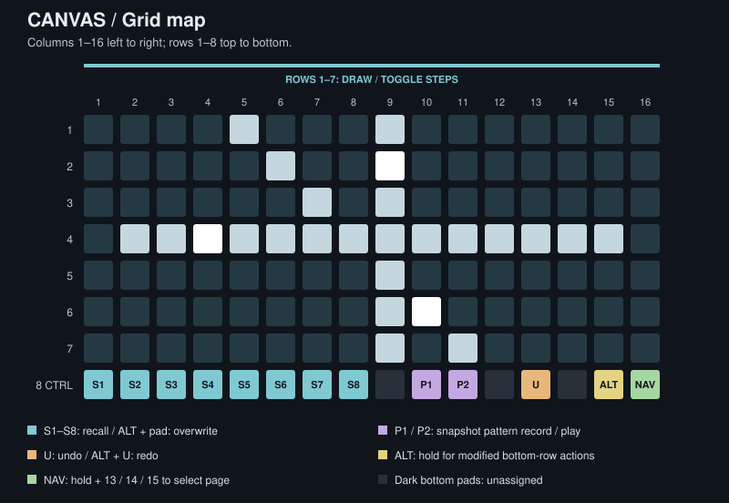
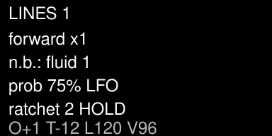
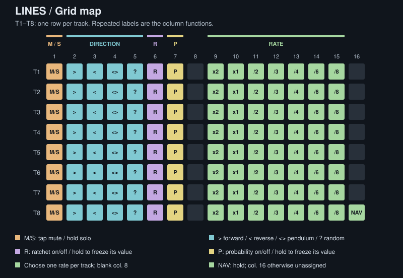
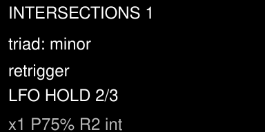
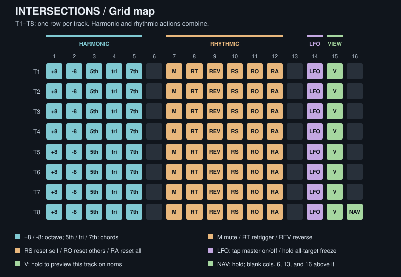
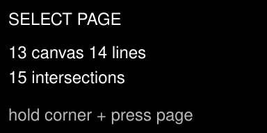
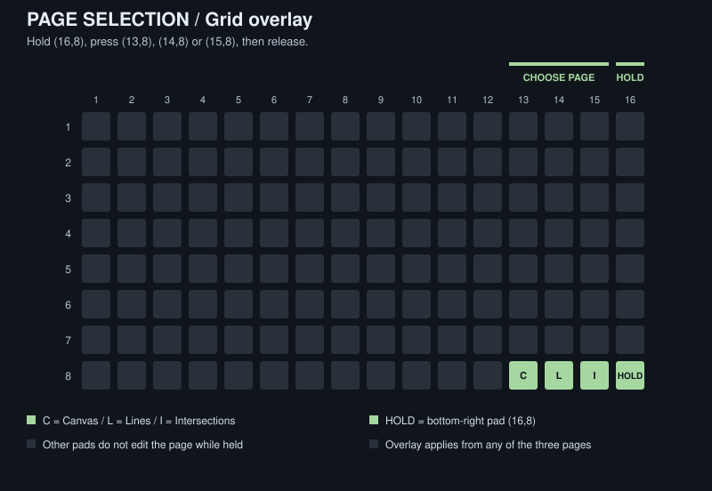
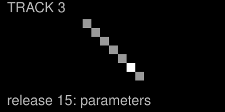

# Anima

**Anima** è un sequencer bidimensionale a otto tracce per monome norns e Grid 16×8. Si disegnano linee sulla Grid; i punti attivi producono note mentre le testine avanzano e si incontrano. Ogni traccia può avere divisione, direzione, articolazione, modulazione e uscita indipendenti.

Anima è un adattamento ed evoluzione di [Animator di Crim](https://github.com/crimclark/animator). Importa i doodle dell’Animator originale e può riprodurre i progetti importati con le regole originali di Animator.

La build preparata è **0.5.6**. Il software è stato esercitato con simulazioni locali; audio, MIDI, Crow, voci n.b. e Grid richiedono ancora verifica sull'hardware. Consulta le [note di verifica](docs/VERIFICA_IT.md).

## Installazione

Servono **norns**, una **Grid 16×8** e **Molly the Poly**. MIDI, Crow e n.b. sono destinazioni di uscita facoltative.

1. Se Molly the Poly non è già installato, inserisci nel REPL di [Maiden](https://monome.org/docs/norns/maiden/):

   ```text
   ;install https://github.com/markwheeler/molly_the_poly
   ```

2. Riavvia norns per caricare il motore, poi installa Anima:

   ```text
   ;install https://github.com/giovannilami/anima
   ```

3. Collega Grid e scegli **anima** nel menu **SELECT**. Disegna una linea usando i due estremi, come spiegato sotto. Imposta scala e suono in **PARAMETERS → EDIT** e configura l'uscita di ciascuna traccia in **TRACK**.

Sono necessari sia il motore `MollyThePoly` sia la sua libreria Lua. Per installare manualmente, copia `anima.lua` e l'intera cartella `lib/` in `dust/code/anima/`. Documentazione e test locali possono restare sul computer. Le voci n.b. disponibili dipendono dalle librerie e dai voice mod installati: Anima non le include.

## Tre pagine per suonare

**Canvas** serve a disegnare e spostare le sequenze; **Lines** controlla la riproduzione delle singole tracce; **Intersections** sceglie cosa accade quando le testine si incontrano. Cambiando pagina cambiano insieme la disposizione dei controlli sulla Grid e la lettura sullo schermo.

Le immagini sono **schemi ingranditi in rapporto 2:1**, come il display norns da 128×64 pixel. Testi e posizione delle righe seguono il codice; i valori sono esempi. Le celle di Canvas sono ingrandite per rendere leggibili le linee e fare toccare per lo spigolo gli step diagonali. Sul dispositivo i quadratini sono più piccoli e distanziati, e il font è quello di norns.

**Come leggere le mappe Grid:** le coordinate sono **(colonna, riga)** e partono dall'angolo in alto a sinistra. I disegni mostrano tutti i 128 pad quadrati, con lo stesso passo sui due assi. I colori distinguono i gruppi di funzioni nella guida; sulla Grid reale le indicazioni sono monocromatiche e usano la luminosità. Le sigle sono una legenda, non scritte presenti sull'hardware. I pad vuoti rimangono disegnati per aiutare a trovare i controlli. Su Lines e Intersections ogni riga corrisponde alla traccia con quel numero; solo le tracce esistenti hanno controlli illuminati. **(16,8)** apre sempre la selezione pagina.

### Canvas: disegnare le sequenze


**Grid: area di disegno e riga di performance**



Le righe **1–7** sono l'area di disegno. Le tre linee usano le stesse coordinate dell'immagine dello schermo sopra. Per la diagonale, per esempio, tieni **(5,1)** e premi **(11,7)**: la distanza è di sei step su entrambi gli assi. Gli otto snapshot sono nei primi otto pad della **riga 8**, separati dal disegno. Tieni prima **ALT (15,8)**, poi premi uno snapshot per memorizzare la scena; rilascia ALT quando hai finito. Il tap semplice richiama lo snapshot. Salva il doodle per conservarli su disco.

**P1 (10,8)** e **P2 (11,8)** registrano ordine e tempi dei richiami snapshot. Premi un pattern vuoto per iniziare, richiama gli snapshot, poi ripremi il pattern per terminare la registrazione e avviare il ciclo. I tap successivi fermano o riavviano la riproduzione. Avviare un pattern vuoto o fermo interrompe l'altro. Tenendo ALT, premere un pattern già registrato lo cancella e avvia una nuova registrazione; se sta registrando, ALT + il suo pad ferma e cancella quella registrazione. Quando la quantizzazione dei pattern è attiva, gli eventi attendono il confine di quantizzazione impostato.

**U (13,8)** annulla l'ultima modifica manuale; **ALT + U** la ripristina. Undo/redo non recupera gli snapshot sovrascritti. **(9,8), (12,8) e (14,8)** non sono assegnati durante l'uso normale di Canvas. Tenendo NAV, (13,8), (14,8) e (15,8) diventano temporaneamente selettori pagina.

Ogni linea è una traccia, con una testina che ne percorre gli step. Fino a **otto tracce** condividono un'area di disegno di **16 colonne × 7 righe**. L'ultima riga della Grid contiene i controlli di performance. La nota associata a ogni cella dipende dalla scala e dalla trasposizione globale: spostare una linea cambia le celle attraversate e le note suonate.

Per disegnare, tieni premuto il primo estremo, premi un secondo pad per l'altro estremo e rilascia. I due pad devono stare sulla stessa riga, sulla stessa colonna oppure formare una **diagonale a 45°**, con uguale distanza orizzontale e verticale. Ogni step diagonale avanza di una colonna e una riga; altre inclinazioni non generano una sequenza.

Nell'immagine ci sono una linea orizzontale, una verticale e una diagonale che interseca entrambe, creando tre celle di incrocio distinte. Questi sono possibili punti d'incontro: le azioni di intersezione si attivano quando le testine che possono suonare arrivano nella stessa cella sullo stesso impulso, secondo tempi e impostazioni di ciascuna traccia.

Premi una cella su una linea per attivarne o disattivarne lo step. Una cella condivisa da più linee ha uno stato di attivazione comune. Gli step correnti attivi sono luminosi; gli altri attivi sono più tenui e quelli disattivati restano debolmente visibili. Tieni premuti i due estremi di una linea esistente per cancellarla.

| Controllo norns | Su Canvas |
| --- | --- |
| E2 | Sposta tutte le linee in verticale |
| E3 | Sposta tutte le linee in orizzontale |
| K2 | Resetta le posizioni di riproduzione |
| K3 | Svuota Canvas |

| Ultima riga Grid | Funzione |
| --- | --- |
| 1–8 | Richiama snapshot |
| Tieni 15 + premi 1–8 | Sovrascrive lo snapshot |
| 10–11 | Registrazione/riproduzione delle sequenze di snapshot |
| 13 | Undo di una modifica manuale |
| Tieni 15 + premi 13 | Redo |
| 15 | Modificatore ALT |
| Tieni 16 | Selezione pagina |
| 9, 12, 14 | Non assegnati |

In basso compare normalmente `K2 reset   K3 clear`, sostituito temporaneamente dal messaggio di salvataggio. Undo/redo riguarda disegno, cancellazione, attivazione degli step, clear e spostamenti con gli encoder durante la sessione.

### Lines: controllare le singole tracce



**Grid: gli stessi controlli ripetuti per ogni traccia**



Leggi **una riga in orizzontale** per controllare la sua traccia. Per esempio **(3,2)** sceglie la direzione indietro della traccia 2 e **(11,2)** il suo rate ÷2. **(1,2)** attiva mute con un tap oppure solo con una pressione di circa **450 ms**. Una seconda pressione lunga disattiva solo. Il gesto lungo non esegue anche il tap mute.

I simboli delle direzioni sono **>** avanti, **<** indietro, **<>** pendolo e **?** casuale. **R** e **P** attivano/disattivano ratchet e probabilità con un tap. Tenendoli per circa 450 ms congeli o rilasci il rispettivo valore senza cambiarne l'interruttore. Per esempio, tieni **(7,2)** per congelare la probabilità della traccia 2 mentre le altre destinazioni LFO continuano a muoversi. Il freeze non assegna una nuova destinazione e non attiva da solo la probabilità.

La colonna **8** separa articolazione e rate. La colonna **16** non contiene controlli di traccia: solo il pad in basso è NAV. Nella riga 8, le colonne 1–15 controllano la **traccia 8**, non gli snapshot. Tieni NAV prima di usare i selettori pagina per evitare di modificare quella traccia.

Ogni riga Grid corrisponde a una traccia. **E1** sceglie la traccia; anche agire sui suoi controlli Grid la seleziona. Lo schermo riporta i suoi valori. **E2** sposta solo quella traccia in verticale, **E3** in orizzontale.

| Colonna Grid | Funzione sulla traccia della riga |
| --- | --- |
| 1 | Tap: mute; pressione lunga: solo |
| 2–5 | Avanti, indietro, pendolo, casuale |
| 6 | Tap: ratchet; pressione lunga: congela/rilascia il suo valore modulato |
| 7 | Tap: probabilità; pressione lunga: congela/rilascia il suo valore modulato |
| 8 | Separatore non assegnato |
| 9–15 | Rate: ×2, ×1, ÷2, ÷3, ÷4, ÷6, ÷8 |

Percentuale di probabilità, numero di colpi del ratchet, uscita e altri valori sono in **PARAMETERS → EDIT → TRACK**. La pressione lunga su ratchet o probabilità esegue il freeze senza aggiungere il tap. I controlli congelati lampeggiano sulla Grid.

L'immagine si legge dall'alto verso il basso:

| Riga sullo schermo | Significato nell'esempio |
| --- | --- |
| `LINES  1` | È selezionata la traccia 1. `ORIG` si aggiunge quando è attivo il playback originale di Animator. |
| `forward x1` | Direzione avanti al rate base. Qui appaiono anche `MUTE` e `SOLO` quando attivi. |
| `n.b.: fluid 1` | Destinazione di uscita e voce n.b. assegnata. I nomi troppo lunghi vengono abbreviati. |
| `prob 75% LFO` | Probabilità attiva al 75%, attualmente controllata da un LFO. |
| `ratchet 2 HOLD` | Ratchet attivo con due colpi; il suo valore modulato è congelato. |
| `O+1 T-12 L120 V96` | Altre destinazioni assegnate: ottava, trasposizione in semitoni, durata in millisecondi e velocity. |

`BASE` indica il valore manuale, `LFO` quello modulato e `HOLD` quello congelato. L'ultima riga mostra solo le destinazioni assegnate; un `*` segnala un valore congelato. Il suffisso `off` indica probabilità o ratchet disabilitati. `INT` sulla riga ratchet segnala che il conteggio viene usato per il retrigger alle intersezioni invece del ratchet continuo.

### Intersections: scegliere cosa succede all'incontro



**Grid: gruppi armonico, ritmico e modulazione**



Ogni riga si legge **scelta armonica → scelta ritmica → LFO → anteprima**. **+8 / −8** significano un'ottava sopra/sotto, non otto semitoni. **5th** aggiunge una quinta; **tri** e **7th** scelgono una triade o un accordo di settima, con il tipo impostato in TRACK.

Le sigle ritmiche sono **M** mute, **RT** retrigger, **REV** reverse, **RS** reset self, **RO** reset others e **RA** reset all. Queste scelte entrano in gioco all'intersezione. Per esempio, premi **(4,3)** per la triade della traccia 3 e **(8,3)** per il retrigger della stessa traccia. Ripremere uno dei due pad selezionati disattiva quel gruppo mantenendo l'altra scelta.

**LFO (14,riga)** è il master delle modulazioni della traccia: tap per on/off, pressione di circa 450 ms per congelare tutte le destinazioni assegnate o rilasciare il freeze di gruppo. Le assegnazioni si creano in EDIT → LFO. **V (15,riga)** mostra l'anteprima solo mentre resta premuto. Per esempio, tieni **(15,3)** per vedere la traccia 3 sullo schermo norns; rilascia per tornare ai valori di Intersections.

Le colonne **6** e **13** separano i gruppi e non eseguono azioni. Anche la colonna **16** è vuota, tranne NAV in basso. La riga 8 controlla la traccia 8 fino a quando tieni NAV.

Per ogni traccia puoi combinare un'azione armonica e una ritmica. Entrano in gioco quando più testine ammesse a suonare raggiungono la stessa cella attiva sullo stesso impulso. Rate, direzioni, pause e probabilità cambiano la frequenza di questi incontri: l'incrocio del disegno da solo non applica un effetto continuo.

Ogni riga Grid continua a rappresentare una traccia. Premi l'azione desiderata per selezionarla; premila di nuovo per riportare quel gruppo a `none`. Le due azioni si possono combinare.

| Colonna Grid | Funzione |
| --- | --- |
| 1–5 | Ottava sopra, ottava sotto, quinta, triade, settima |
| 6 | Separatore non assegnato |
| 7–12 | Mute, retrigger, reverse, reset self, reset others, reset all |
| 13 | Non assegnata |
| 14 | Tap: master LFO della traccia; pressione lunga: congela/rilascia tutte le destinazioni assegnate |
| 15 | Tieni premuto per vedere sullo schermo la linea di quella riga |

Il tipo di triade o settima si sceglie in **PARAMETERS → EDIT → TRACK**. **E1** seleziona la traccia, **E2/E3** la spostano. Le opzioni disponibili sono tenui, quelle scelte luminose, quelle congelate lampeggiano; le righe senza traccia rimangono spente.

Nell'esempio, la traccia 1 genera una **triade minore** ed esegue un **retrigger** quando partecipa a un incontro. `LFO HOLD 2/3` significa che due delle tre destinazioni attive sono congelate; la terza può continuare a muoversi. In basso, `x1  P75%  R2 int` riassume rate, probabilità e conteggio effettivo dei colpi.

La riga LFO può mostrare anche `off`, `ON` o `ON no targets`. In basso, `Poff` e `Roff` indicano i rispettivi controlli spenti. `R2 int` significa due colpi al retrigger di intersezione con ratchet continuo disabilitato. Durante la modulazione lo schermo si aggiorna circa dieci volte al secondo; i valori musicali vengono campionati a inizio step.

### Cambiare pagina



**La Grid mentre tieni NAV**



Premi e tieni **NAV (16,8) prima** di toccare il selettore pagina. Le altre funzioni dell'ultima riga sono sospese: **(13,8)** seleziona Canvas, **(14,8)** Lines e **(15,8)** Intersections. Rilascia i pad per tornare ai controlli normali. Il gesto funziona da ogni pagina; tenere NAV da solo non cambia pagina. Durante questa vista gli altri pad non modificano il contenuto.

Tieni premuto il pad in basso a destra **(16,8)**, premi un selettore e rilascia:

| Pad | Pagina |
| --- | --- |
| (13,8) | Canvas |
| (14,8) | Lines |
| (15,8) | Intersections |

La schermata temporanea `SELECT PAGE` ricorda i tre comandi. Tenere l'angolo da solo lascia selezionata la pagina corrente. Mentre lo tieni premuto, la navigazione ha precedenza sugli altri controlli dell'ultima riga, compresi undo e i controlli della traccia 8.

### Anteprima di una traccia



Su Intersections, tieni premuta la **colonna 15 sulla riga di una traccia**. Lo schermo mostra temporaneamente solo la sua linea e la testina in movimento; Grid rimane sulla pagina Intersections. Nell'esempio `TRACK 3` identifica la traccia. Rilasciando il pad torni ai parametri, come ricorda `release 15: parameters`.

Puoi così osservare il disegno di una singola linea mantenendo disponibili i controlli delle intersezioni. È una vista temporanea, non una quarta pagina di performance.

## Salvare, caricare e importare

I progetti Anima sono in `dust/data/anima/`. Usa **PARAMETERS → EDIT → SAVE/LOAD → save doodle / load doodle**. Conserva insieme `.doodle` e `.pset` con lo stesso nome: il preset contiene anche le impostazioni sonore.

Per importare un progetto dell'Animator originale, scegli **load Animator original** nello stesso menu: apre `dust/data/animator/`. Il `.pset` deve essere accanto al `.doodle`. Salvare da Anima crea una nuova coppia in `dust/data/anima/`, conservando i file originali nella loro cartella.

## Modulazione e uscite

Ogni traccia ha due LFO indipendenti, fino a due destinazioni per LFO: probabilità, velocity, durata, rate, ottava, trasposizione in semitoni o ratchet. In **EDIT → LFO**, `section` sceglie general LFO o traccia 1–8; `oscillator` sceglie LFO 1/2. Sono mantenuti i due LFO globali originali X/Y. LFO sostituisce il valore manuale mentre è attivo; il freeze mantiene l'ultimo valore musicale campionato senza fermare le altre destinazioni.

Ogni traccia può uscire su synth interno, n.b., MIDI, coppie Crow fisse, Crow CV originale, Just Friends, ER-301 o combinazioni MIDI supportate. Le coppie Crow sono monofoniche; per gli accordi usa un'uscita polifonica.

Per i dettagli su importazione, snapshot, undo/redo, gesture, ratchet e probabilità consulta la [guida italiana completa](docs/GUIDA_IT.md). La [verifica software](docs/VERIFICA_IT.md) riporta 134 scenari locali superati e descrive quali controlli hardware restano da fare.

Leggi il [changelog](docs/CHANGELOG.md) per la storia delle versioni 0.5.x.

## Sviluppo

Sviluppato da Giovanni Lami con assistenza AI (ChatGPT / OpenAI Codex) per implementazione, debug, test e documentazione. Direzione musicale, scelte sulle funzioni e valutazione sullo strumento sono di Giovanni Lami. Il concetto originale di Animator e il codice ereditato restano attribuiti a Crim e ai contributori indicati sotto.

## Crediti e licenza

Basato su [Animator di Crim](https://github.com/crimclark/animator); l'implementazione originale degli LFO di posizione attribuisce @justmat in `lib/hnds.lua`. Adattamento sviluppato da Giovanni Lami.

Ho contattato Crim su Lines per chiedere informazioni sulla condivisione di questo adattamento e sulla relativa licenza, senza aver ancora ricevuto risposta. Durante la preparazione non ho trovato una licenza nel repository originale di Animator.

Se gli autori originali desiderano discutere crediti, licenza o disponibilità di questo adattamento, possono aprire una issue o contattarmi. Al codice ereditato non è stata assegnata una licenza open source generale.
