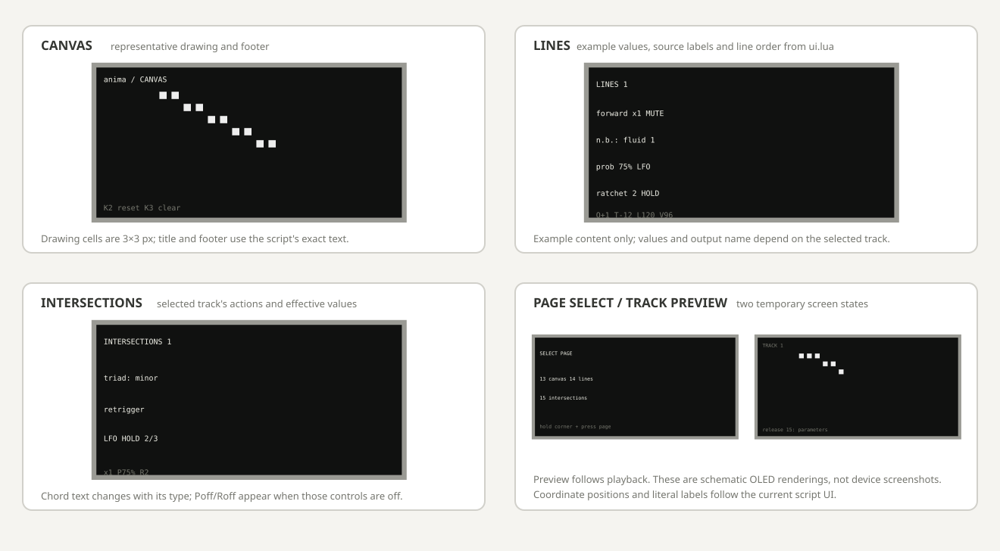

# Anima

**Anima** è un sequencer bidimensionale a otto tracce per monome norns e Grid 16×8. Si disegnano linee sulla Grid; i punti attivi producono note mentre le linee avanzano e si incrociano. Ogni traccia può avere divisione, direzione, articolazione, modulazione e uscita indipendenti.

Anima è un adattamento ed evoluzione di [Animator di Crim](https://github.com/crimclark/animator). Importa i doodle di Animator e Animator 2 e può riprodurre i progetti importati con le regole originali di Animator.

La build preparata è **0.5.6**. Il software è stato esercitato con simulazioni locali; audio, MIDI, Crow, voci n.b. e Grid richiedono ancora verifica sull'hardware. Consulta le [note di verifica](docs/VERIFICA_IT.md).

## Cosa mostra lo schermo

Gli schemi sono rappresentazioni approssimative basate su `lib/ui.lua`, non screenshot fedeli ai pixel; il disegno, la traccia selezionata e i valori cambiano durante l'uso.



## Installazione

Copia la cartella `anima` in `dust/code/` con [Maiden](https://monome.org/docs/norns/maiden/), poi scegli `anima` dal menu SELECT. Una volta pubblicato il repository, si potrà installare dal REPL Maiden con:

```text
;install https://github.com/giovannilami/anima
```

Anima richiede il motore `MollyThePoly` e la relativa libreria. Se Molly the Poly non è già installato, inserisci nel REPL di Maiden il seguente comando e riavvia norns prima di avviare Anima:

```text
;install https://github.com/markwheeler/molly_the_poly
```

Grid è necessaria per disegnare e suonare le viste. MIDI, Crow, Just Friends, ER-301 e n.b. sono uscite facoltative. Le voci n.b. dipendono dalle librerie e dai voice mod installati sul dispositivo; Anima non include il codice di quelle voci.

I progetti vengono salvati in `dust/data/anima/`. Da **PARAMETERS → EDIT → SAVE/LOAD** si possono importare un doodle di Animator 2 o di Animator originale insieme al relativo `.pset`. L'importazione non modifica i file sorgente; salvare da Anima crea una nuova coppia di file.

## Grid

Tieni premuto **(16,8)**, premi un selettore e rilascia:

| Pad | Vista |
| --- | --- |
| (13,8) | Canvas |
| (14,8) | Lines |
| (15,8) | Intersections |

Il pad d'angolo da solo non cambia vista. Durante la navigazione, questi selettori hanno precedenza sugli altri controlli dell'ultima riga, inclusi quelli della traccia 8.

### Canvas

Tieni premuti due pad per disegnare una linea orizzontale, verticale o diagonale. Premi i pad sulla linea per attivare o disattivare gli step. Nell'ultima riga: 1–8 snapshot; 10–11 sequenze di snapshot; 13 undo; 15 ALT. I pad 9, 12 e 14 sono vuoti. **ALT + 13** esegue redo; tenere ALT e premere uno snapshot lo sovrascrive.

Su Canvas, E2 sposta tutte le linee in verticale ed E3 le sposta in orizzontale. K2 resetta la vista; K3 la svuota. Undo riguarda le modifiche manuali e dura per la sessione.

### Lines

Ogni riga controlla una traccia. Colonna 1: tap mute, pressione lunga solo. Colonne 2–5: direzione. Colonna 6: ratchet. Colonna 7: probabilità. Colonna 8: separatore. Colonne 9–15: ×2, ×1, ÷2, ÷3, ÷4, ÷6, ÷8. Una pressione lunga su 6 o 7 congela o rilascia quel valore modulato; non esegue anche il tap.

E1 seleziona la traccia, E2/E3 la spostano. Quantità di probabilità, numero di ripetizioni e altri valori si configurano in **PARAMETERS → EDIT → TRACK**.

### Intersections

Colonne 1–5: azioni armoniche; 6: separatore; 7–12: azioni ritmiche. Premi di nuovo l'azione selezionata per disattivarla. Colonna 13 è vuota. Colonna 14 abilita o disabilita il master LFO della traccia; una pressione lunga congela o rilascia tutte le destinazioni assegnate. Tieni la colonna 15 sulla riga di una traccia per vederne il disegno sullo schermo Norns mentre Grid resta sulla pagina Intersections.

## Riferimento display

Canvas mostra il disegno, `anima / CANVAS` e il messaggio di salvataggio o `K2 reset   K3 clear`. Lines mostra direzione/rate, mute/solo attivi, uscita e voce n.b., probabilità e ratchet con sorgente `BASE`, `LFO` o `HOLD`, oltre alle altre destinazioni assegnate (`O` ottava, `T` trasposizione, `L` durata in millisecondi, `V` velocity). L'asterisco indica un valore congelato.

Intersections mostra le azioni correnti, stato LFO e rate/probabilità/ratchet effettivi. `Poff` e `Roff` indicano i controlli disabilitati; `R2 int` segnala il retrigger alle intersezioni. Le letture aggiornano lo schermo circa dieci volte al secondo; i valori musicali vengono applicati a inizio step.

## Modulazione e uscite

Ogni traccia ha due LFO indipendenti, fino a due destinazioni per LFO: probabilità, velocity, durata, rate, ottava, trasposizione in semitoni o ratchet. In **EDIT → LFO**, `section` sceglie general LFO o traccia 1–8; `oscillator` sceglie LFO 1/2. Sono mantenuti i due LFO globali originali X/Y. LFO sostituisce il valore manuale mentre è attivo; il freeze mantiene l'ultimo valore musicale campionato senza fermare le altre destinazioni.

Ogni traccia può uscire su synth interno, n.b., MIDI, coppie Crow fisse, Crow CV originale, Just Friends, ER-301 o combinazioni MIDI supportate. Le coppie Crow sono monofoniche; per gli accordi usa un'uscita polifonica.

Per i dettagli su importazione, snapshot, undo/redo, gesture, ratchet e probabilità consulta la [guida italiana completa](docs/GUIDA_IT.md). La [verifica software](docs/VERIFICA_IT.md) riporta 134 scenari locali superati e descrive quali controlli hardware restano da fare.

Leggi il [changelog](docs/CHANGELOG.md) per la storia delle versioni 0.5.x.

## Crediti e licenza

Basato su [Animator di Crim](https://github.com/crimclark/animator); l'implementazione originale degli LFO di posizione attribuisce @justmat in `lib/hnds.lua`. Adattamento sviluppato da Giovanni Lami.

Ho contattato Crim su Lines per chiedere informazioni sulla condivisione di questo adattamento e sulla relativa licenza, senza aver ancora ricevuto risposta. Durante la preparazione non ho trovato una licenza nel repository originale di Animator.

Se gli autori originali desiderano discutere crediti, licenza o disponibilità di questo adattamento, possono aprire una issue o contattarmi. Al codice ereditato non è stata assegnata una licenza open source generale.
